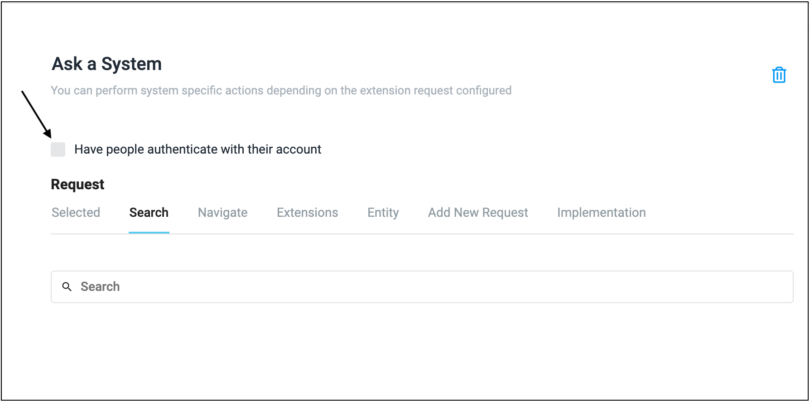
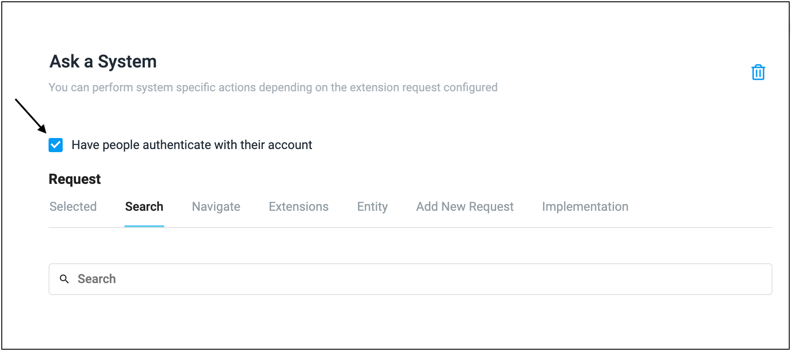

  # Authentication

## Overview

The Microsoft Entra ID Extension uses OAuth 2.0 authentication through Microsoft's identity platform to securely access your Microsoft Entra ID tenant. The extension supports two authentication modes to accommodate different use cases:

1. **Service Account Authentication** - Uses a single service account for all operations (recommended for automated workflows)
2. **User Account Authentication** - Each user authenticates with their own Microsoft Entra ID account (for user-specific operations)

This document provides comprehensive information about authentication modes, OAuth 2.0 flows, token management, and security best practices.

## Authentication Modes

### Service Account Authentication

**When to Use**:
- Automated workflows and scheduled tasks
- System-to-system integrations
- Background processes that don't require user interaction
- Bulk operations on user accounts

**How It Works**:
- A single administrator account authenticates once
- The refresh token is stored and reused for all operations
- All operations are performed with the service account's permissions
- No user interaction required after initial setup

**Configuration**:
- Uncheck "Have people authenticate with their account" in extension setup
- Provide administrator email in the Email field
- Complete OAuth authorization once during setup
- Refresh token is associated with the administrator email

**Permissions**:
- Operations are subject to the service account's permissions in Microsoft Entra ID
- Service account must have appropriate admin roles (e.g., User Administrator, Global Administrator)

**Best Practices**:
- Use a dedicated service account (not a personal account)
- Enable Multi-Factor Authentication (MFA) on the service account
- Regularly review service account permissions
- Monitor service account activity in sign-in logs



### User Account Authentication

**When to Use**:
- Operations that should be performed in the context of individual users
- Audit trails requiring user-specific attribution
- Scenarios where user consent is required
- Delegated permissions model

**How It Works**:
- Each user must authenticate with their own Microsoft Entra ID account
- Each user gets their own access and refresh tokens
- Operations are performed with the authenticated user's permissions
- User interaction required for each new user

**Configuration**:
- Check "Have people authenticate with their account" in extension setup
- Each user will be prompted to authenticate when they first use the extension
- Tokens are stored per user

**Permissions**:
- Operations are subject to each user's permissions in Microsoft Entra ID
- Users can only perform actions they're authorized to do
- Follows principle of least privilege

**Best Practices**:
- Ensure users have appropriate permissions before using the extension
- Educate users about the consent screen and required permissions
- Monitor per-user activity in Microsoft Entra ID logs



## OAuth 2.0 Scopes and Permissions

The Microsoft Entra ID Extension requires the following OAuth 2.0 scopes to function properly:

### Required Scopes

| Scope | Permission Type | Purpose | Description |
|-------|----------------|---------|-------------|
| `openid` | Delegated | Basic authentication | Allows users to sign in with their work or school account |
| `offline_access` | Delegated | Refresh token | Allows the app to maintain access without user interaction |
| `User.ReadWrite.All` | Delegated/Application | User management | Read and write all user profiles, create/update/delete users |
| `UserAuthenticationMethod.ReadWrite.All` | Delegated/Application | Password reset | Manage user authentication methods including password reset |

### Scope Details

#### openid
- **Full URL**: `https://graph.microsoft.com/openid`
- **Purpose**: Enables OpenID Connect authentication
- **Allows**: User sign-in with Microsoft Entra ID credentials
- **Required For**: All authentication flows

#### offline_access
- **Full URL**: `https://graph.microsoft.com/offline_access`
- **Purpose**: Enables refresh token issuance
- **Allows**: Long-running access without repeated user authentication
- **Required For**: Service account mode and seamless token refresh

#### User.ReadWrite.All
- **Full URL**: `https://graph.microsoft.com/User.ReadWrite.All`
- **Purpose**: Comprehensive user management
- **Allows**:
  - Read all user profiles
  - Create new user accounts
  - Update existing user information
  - Delete user accounts
  - Enable/disable user accounts
  - Manage group memberships
- **Required For**: All catalog requests except password reset
- **Admin Consent**: Required

#### UserAuthenticationMethod.ReadWrite.All
- **Full URL**: `https://graph.microsoft.com/UserAuthenticationMethod.ReadWrite.All`
- **Purpose**: Authentication method management
- **Allows**:
  - Reset user passwords
  - Force password change on next login
  - Manage authentication methods
- **Required For**: Reset Password catalog request
- **Admin Consent**: Required

### Admin Consent

All required scopes need **admin consent** because they access sensitive user data and perform privileged operations.

**How to Grant Admin Consent**:
1. Navigate to your app registration in Microsoft Entra ID
2. Go to **API permissions**
3. Click **Grant admin consent for [Your Organization]**
4. Confirm the consent prompt

**Who Can Grant Consent**:
- Global Administrator
- Privileged Role Administrator
- Application Administrator (for some permissions)

## OAuth 2.0 Grant Types

The extension uses two OAuth 2.0 grant types:

### 1. Authorization Code Grant

**Purpose**: Initial authentication and token acquisition

**Flow**:
1. User clicks "Validate" or "Test Connection" in Krista
2. User is redirected to Microsoft Entra ID login page
3. User signs in with credentials
4. User grants consent (first time only)
5. Microsoft Entra ID redirects back with authorization code
6. Extension exchanges code for access token and refresh token

**Request Example**:
```http
POST https://login.microsoftonline.com/{tenant}/oauth2/v2.0/token
Content-Type: application/x-www-form-urlencoded

client_id={client_id}
&scope=openid offline_access User.ReadWrite.All UserAuthenticationMethod.ReadWrite.All
&code={authorization_code}
&redirect_uri={redirect_uri}
&grant_type=authorization_code
&client_secret={client_secret}
```

**Response Example**:
```json
{
  "token_type": "Bearer",
  "scope": "openid offline_access User.ReadWrite.All UserAuthenticationMethod.ReadWrite.All",
  "expires_in": 3600,
  "access_token": "eyJ0eXAiOiJKV1QiLCJhbGciOiJSUzI1NiIsIng1dCI6...",
  "refresh_token": "0.AXoAl-GWDi3bQ0SvpYCJxEwDW..."
}
```


**Key Points**:
- Used for initial authentication only
- Requires user interaction
- Authorization code is single-use and short-lived (typically 10 minutes)
- Returns both access token and refresh token

### 2. Refresh Token Grant

**Purpose**: Obtain new access tokens without user interaction

**Flow**:
1. Access token expires (after 1 hour)
2. Extension automatically uses refresh token
3. Microsoft Entra ID validates refresh token
4. New access token and refresh token are issued
5. Extension retries the original operation

**Request Example**:
```http
POST https://login.microsoftonline.com/{tenant}/oauth2/v2.0/token
Content-Type: application/x-www-form-urlencoded

client_id={client_id}
&scope=openid offline_access User.ReadWrite.All UserAuthenticationMethod.ReadWrite.All
&refresh_token={refresh_token}
&grant_type=refresh_token
&client_secret={client_secret}
```

**Response Example**:
```json
{
  "token_type": "Bearer",
  "scope": "openid offline_access User.ReadWrite.All UserAuthenticationMethod.ReadWrite.All",
  "expires_in": 3600,
  "access_token": "eyJ0eXAiOiJKV1QiLCJhbGciOiJSUzI1NiIsIng1dCI6...",
  "refresh_token": "0.AXoAl-GWDi3bQ0SvpYCJxEwDW..."
}
```

**Key Points**:
- Used automatically by the extension
- No user interaction required
- Returns new access token and new refresh token (token rotation)
- Enables seamless long-running operations

## Authentication Flow

### Initial Authentication Flow

```
1. User initiates authentication in Krista
   ↓
2. Krista redirects to Microsoft Entra ID login
   URL: https://login.microsoftonline.com/{tenant}/oauth2/v2.0/authorize
   ↓
3. User signs in with Microsoft Entra ID credentials
   ↓
4. Microsoft shows consent screen (first time only)
   User grants requested permissions
   ↓
5. Microsoft Entra ID redirects back to Krista with authorization code
   Private Auth: https://{krista-instance}/rest/microsoftentraid/callback?code={code}&state={state}
   Public Auth: https://{krista-instance}/extension/api/rest/v3/oauth/callback?code={code}&state={state}
   ↓
6. Extension exchanges authorization code for tokens
   POST to: https://login.microsoftonline.com/{tenant}/oauth2/v2.0/token
   ↓
7. Extension receives access token and refresh token
   ↓
8. Extension stores refresh token securely
   ↓
9. Authentication complete - Extension ready to use
```

### Token Refresh Flow

```
1. Extension makes API call with access token
   ↓
2. Access token expired (after 1 hour)
   ↓
3. Microsoft Graph API returns 401 Unauthorized
   ↓
4. Extension automatically uses refresh token
   POST to: https://login.microsoftonline.com/{tenant}/oauth2/v2.0/token
   ↓
5. Microsoft Entra ID validates refresh token
   ↓
6. Microsoft Entra ID issues new access token and refresh token
   ↓
7. Extension stores new refresh token
   ↓
8. Extension retries original API call with new access token
   ↓
9. Operation completes successfully
```

## Token Management

### Access Token

**Lifetime**: 1 hour (3600 seconds)

**Purpose**: Authorizes API requests to Microsoft Graph

**Storage**: In-memory during active session

**Format**: JWT (JSON Web Token)

**Usage**: Included in Authorization header of every API request
```http
Authorization: Bearer {access_token}
```

**Expiration Handling**:
- Extension automatically detects expired tokens
- Triggers refresh token flow
- Retries failed operation with new token

### Refresh Token

**Lifetime**:
- Default: 90 days of inactivity
- Maximum: 1 year (configurable in Microsoft Entra ID)
- Can be revoked by admin or user

**Purpose**: Obtain new access tokens without user interaction

**Storage**: Encrypted in Krista's secure token store

**Format**: Opaque string (not JWT)

**Security**:
- Highly sensitive - treat like a password
- Stored encrypted at rest
- Transmitted only over HTTPS
- Subject to token rotation (new refresh token issued with each use)

**Revocation Scenarios**:
- User password changed
- Admin revokes consent
- User account disabled
- Conditional access policy violation
- Manual revocation by admin

### Token Expiration Scenarios

#### Scenario 1: Access Token Expires (Normal Operation)

**What Happens**:
1. API call fails with 401 Unauthorized
2. Extension uses refresh token to get new access token
3. Operation retries automatically
4. User experiences no interruption

**User Action Required**: None

#### Scenario 2: Refresh Token Expires

**What Happens**:
1. Refresh token grant fails
2. Extension throws MustAuthorizeException
3. User is prompted to re-authenticate

**User Action Required**: Click "Validate" and complete OAuth flow again

#### Scenario 3: Refresh Token Revoked

**What Happens**:
1. Refresh token grant fails with invalid_grant error
2. Extension clears stored tokens
3. User is prompted to re-authenticate

**User Action Required**: Click "Validate" and complete OAuth flow again

**Common Causes**:
- User password changed
- Admin revoked app consent
- Conditional access policy changed
- User account disabled

## Security Best Practices

### 1. Protect Client Credentials

- **Never expose client secret** in client-side code or version control
- **Rotate client secrets** regularly (every 6-12 months)
- **Use Azure Key Vault** for additional security in production
- **Set expiration reminders** 30 days before secret expires

### 2. Use Least Privilege

- **Grant minimum required permissions** - don't request unnecessary scopes
- **Use Service Account mode** for automated workflows
- **Use User Account mode** when user context is required
- **Regularly review** granted permissions

### 3. Monitor Authentication Activity

- **Review sign-in logs** in Microsoft Entra ID regularly
- **Set up alerts** for unusual authentication patterns
- **Monitor failed authentication** attempts
- **Track token refresh** patterns

### 4. Implement Conditional Access

- **Require MFA** for service accounts
- **Restrict access** by IP address or location
- **Enforce device compliance** policies
- **Block legacy authentication** protocols

### 5. Handle Token Expiration Gracefully

- **Implement retry logic** for transient failures
- **Detect token expiration** before making API calls
- **Refresh tokens proactively** when nearing expiration
- **Provide clear error messages** to users

### 6. Secure Token Storage

- **Encrypt tokens** at rest
- **Use secure key management** for encryption keys
- **Limit token access** to authorized processes only
- **Clear tokens** when no longer needed

## Troubleshooting Authentication

### Authentication Fails with "invalid_client"

**Symptom**: Error message "invalid_client" during OAuth flow

**Possible Causes**:
1. Client ID is incorrect
2. Client secret is incorrect or expired
3. App registration is disabled

**Resolution**:
1. Verify Client ID from app registration Overview
2. Generate new client secret if expired
3. Ensure app registration is enabled in Microsoft Entra ID

### Authentication Fails with "redirect_uri_mismatch"

**Symptom**: Error about redirect URI not matching

**Possible Causes**:
1. Redirect URI not configured in app registration
2. Redirect URI doesn't match exactly (case-sensitive)
3. Wrong platform type selected

**Resolution**:
1. Add redirect URI to app registration under Authentication
2. Verify exact match including protocol (https://)
3. Use "Web" platform, not "Single-page application"

### Refresh Token Fails with "invalid_grant"

**Symptom**: Token refresh fails, user must re-authenticate

**Possible Causes**:
1. Refresh token expired (90 days of inactivity)
2. User password changed
3. Admin revoked consent
4. Conditional access policy violation

**Resolution**:
1. Re-authenticate through "Validate" button
2. Ensure service account password is stable
3. Re-grant admin consent if revoked
4. Review and adjust conditional access policies

### "Insufficient Privileges" Error

**Symptom**: API calls fail with insufficient privileges

**Possible Causes**:
1. Required API permissions not granted
2. Admin consent not provided
3. Service account lacks necessary roles

**Resolution**:
1. Verify all required scopes are added to app registration
2. Grant admin consent for API permissions
3. Assign appropriate admin roles to service account

### Token Refresh Stops Working

**Symptom**: Extension repeatedly prompts for authentication

**Possible Causes**:
1. Refresh token storage corrupted
2. Token rotation not handled properly
3. Network connectivity issues

**Resolution**:
1. Clear stored tokens and re-authenticate
2. Verify extension is storing new refresh tokens
3. Check network connectivity to Microsoft Graph API

## See Also

- [Extension Configuration](pages/ExtensionConfiguration.md) - Complete setup guide
- [Creating Microsoft Entra ID App](pages/CreatingMicrosoftEntraIDApp.md) - App registration guide
- [Microsoft Identity Platform Documentation](https://learn.microsoft.com/en-us/azure/active-directory/develop/) - Official Microsoft documentation
- [Microsoft Graph API Permissions](https://learn.microsoft.com/en-us/graph/permissions-reference) - Permission reference