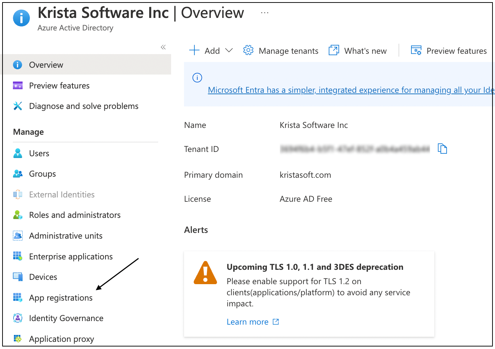
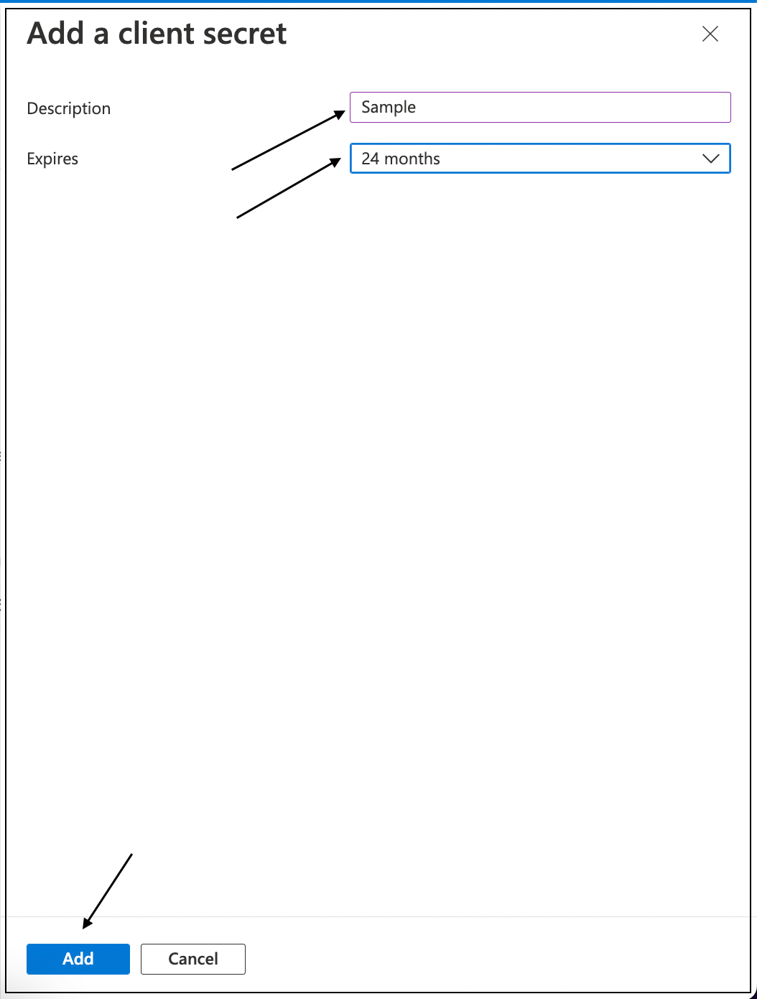
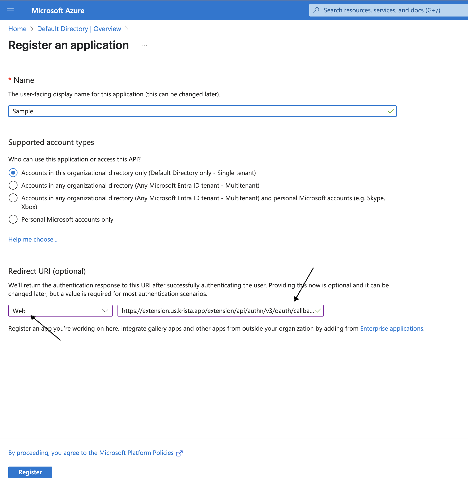

# Creating Microsoft Entra ID App

## Overview

Before you can use the Microsoft Entra ID Extension, you must create an app registration in your Microsoft Entra ID tenant. This app registration provides the credentials (Client ID, Client Secret, Tenant ID) needed to authenticate and authorize the extension to access your Microsoft Entra ID resources.

This guide provides step-by-step instructions for creating and configuring a Microsoft Entra ID app registration for use with the Krista extension.

## Prerequisites

Before you begin, ensure you have:

- **Microsoft Entra ID Tenant**: An active Microsoft Entra ID tenant (formerly Azure Active Directory)
- **Administrative Access**: One of the following roles:
  - Global Administrator
  - Application Administrator
  - Cloud Application Administrator
- **Microsoft Azure Portal Access**: Access to [https://portal.azure.com](https://portal.azure.com)

## Step-by-Step Instructions

### Step 1: Navigate to Microsoft Entra ID

1. Sign in to the [Azure Portal](https://portal.azure.com)
2. In the search bar at the top, type "Microsoft Entra ID" or "Azure Active Directory"
3. Click on **Microsoft Entra ID** from the search results

### Step 2: Access App Registrations

1. In the left navigation menu, click on **App registrations**
2. Click the **+ New registration** button at the top

### Step 3: Register the Application

1. **Name**: Enter a descriptive name for your application
   - Example: "Krista Microsoft Entra ID Extension"
   - This name is visible to users during consent

2. **Supported account types**: Select one of the following:
   - **Accounts in this organizational directory only (Single tenant)** - Recommended for most cases
   - Choose this if the extension will only access your organization's Microsoft Entra ID

3. **Redirect URI**: 
   - Platform: Select **Web**
   - URI: Leave blank for now (you'll add this later from Krista)
   - Format will be: `https://<your-krista-instance>/rest/microsoftentraid/callback`

4. Click **Register**

### Step 4: Note the Application (Client) ID and Tenant ID

After registration, you'll be taken to the app's Overview page.

1. **Application (client) ID**: Copy this GUID - you'll need it for Krista configuration
2. **Directory (tenant) ID**: Copy this GUID - you'll need it for Krista configuration

**Important**: Save these values securely. You'll need them when configuring the extension in Krista.

### Step 5: Create a Client Secret

1. In the left navigation menu, click on **Certificates & secrets**
2. Click the **+ New client secret** button
3. **Description**: Enter a description (e.g., "Krista Extension Secret")
4. **Expires**: Select an expiration period
   - Recommended: 12 months or 24 months
   - **Important**: Set a calendar reminder to renew before expiration
5. Click **Add**

6. **Copy the client secret VALUE immediately**
   - The secret value is only shown once
   - If you miss it, you'll need to create a new secret
   - Store it securely (e.g., password manager, Azure Key Vault)

**Security Note**: Treat the client secret like a password. Never commit it to version control or expose it in client-side code.

### Step 6: Configure API Permissions

1. In the left navigation menu, click on **API permissions**
2. Click **+ Add a permission**
3. Select **Microsoft Graph**
4. Select **Delegated permissions**
5. Search for and add the following permissions:
   - `openid`
   - `offline_access`
   - `User.ReadWrite.All`
   - `UserAuthenticationMethod.ReadWrite.All`

6. Click **Add permissions**

**Permission Details**:
- **openid**: Enables OpenID Connect authentication
- **offline_access**: Allows refresh token issuance for long-running access
- **User.ReadWrite.All**: Enables user account management (create, read, update, delete)
- **UserAuthenticationMethod.ReadWrite.All**: Enables password reset functionality

### Step 7: Grant Admin Consent

After adding permissions, you must grant admin consent:

1. Click the **Grant admin consent for [Your Organization]** button
2. Review the permissions in the consent dialog
3. Click **Yes** to confirm

**Why Admin Consent is Required**:
- The requested permissions access sensitive user data
- They perform privileged operations (create/delete users, reset passwords)
- Only administrators can grant these permissions

**Verification**:
- After granting consent, you should see green checkmarks in the "Status" column
- Status should show "Granted for [Your Organization]"

### Step 8: Configure Redirect URI

1. In the left navigation menu, click on **Authentication**
2. Under **Platform configurations**, click **+ Add a platform**
3. Select **Web**
4. Enter your redirect URI:
   - Format: `https://<your-krista-instance>/rest/microsoftentraid/callback`
   - Example: `https://prod.krista.ai/rest/microsoftentraid/callback`
5. Click **Configure**

**Important**: The redirect URI must match exactly (including https://) between your Krista configuration and this app registration.

### Step 9: Verify Configuration

Before proceeding to Krista, verify your app registration:

- [ ] Application (client) ID copied and saved
- [ ] Directory (tenant) ID copied and saved
- [ ] Client secret value copied and saved securely
- [ ] All 4 required API permissions added
- [ ] Admin consent granted (green checkmarks visible)
- [ ] Redirect URI configured correctly
- [ ] Redirect URI uses HTTPS protocol

## Next Steps

Now that you've created your Microsoft Entra ID app registration, you're ready to configure the extension in Krista:

1. Navigate to the Microsoft Entra ID Extension in your Krista workspace
2. Follow the [Extension Configuration](pages/ExtensionConfiguration.md) guide
3. Enter the Client ID, Client Secret, and Tenant ID you collected
4. Complete the OAuth authorization flow
5. Test the connection

## Troubleshooting

### Cannot Create App Registration

**Issue**: "You do not have permission to create app registrations"

**Resolution**:
- Contact your Global Administrator
- Request Application Administrator or Cloud Application Administrator role
- Or ask an admin to create the app registration for you

### Cannot Grant Admin Consent

**Issue**: "Grant admin consent" button is grayed out

**Resolution**:
- You need Global Administrator or Privileged Role Administrator role
- Contact your Global Administrator to grant consent
- Or use the admin consent URL (advanced)

### Client Secret Not Visible

**Issue**: Forgot to copy client secret value

**Resolution**:
- You cannot retrieve the secret value after leaving the page
- Create a new client secret
- Delete the old secret (optional, but recommended for security)

### Redirect URI Mismatch Error

**Issue**: Authentication fails with redirect URI mismatch

**Resolution**:
- Verify the redirect URI in app registration matches exactly
- Check for typos, extra spaces, or incorrect protocol (http vs https)
- Ensure you selected "Web" platform, not "Single-page application"

## See Also

- [Extension Configuration](pages/ExtensionConfiguration.md) - Configure the extension in Krista
- [Authentication](pages/Authentication.md) - Understand OAuth 2.0 authentication flow
- [Microsoft Entra ID App Registration Documentation](https://learn.microsoft.com/en-us/azure/active-directory/develop/quickstart-register-app) - Official Microsoft documentation
