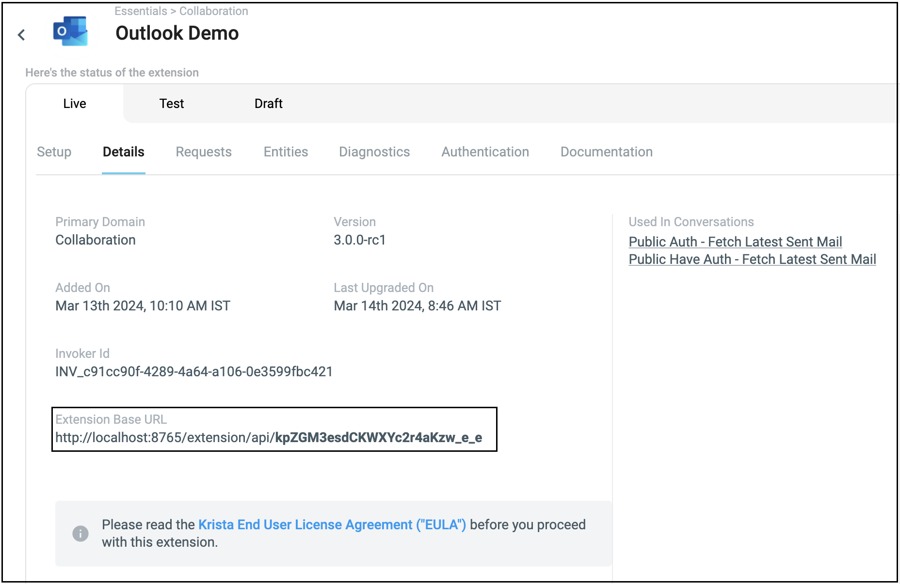
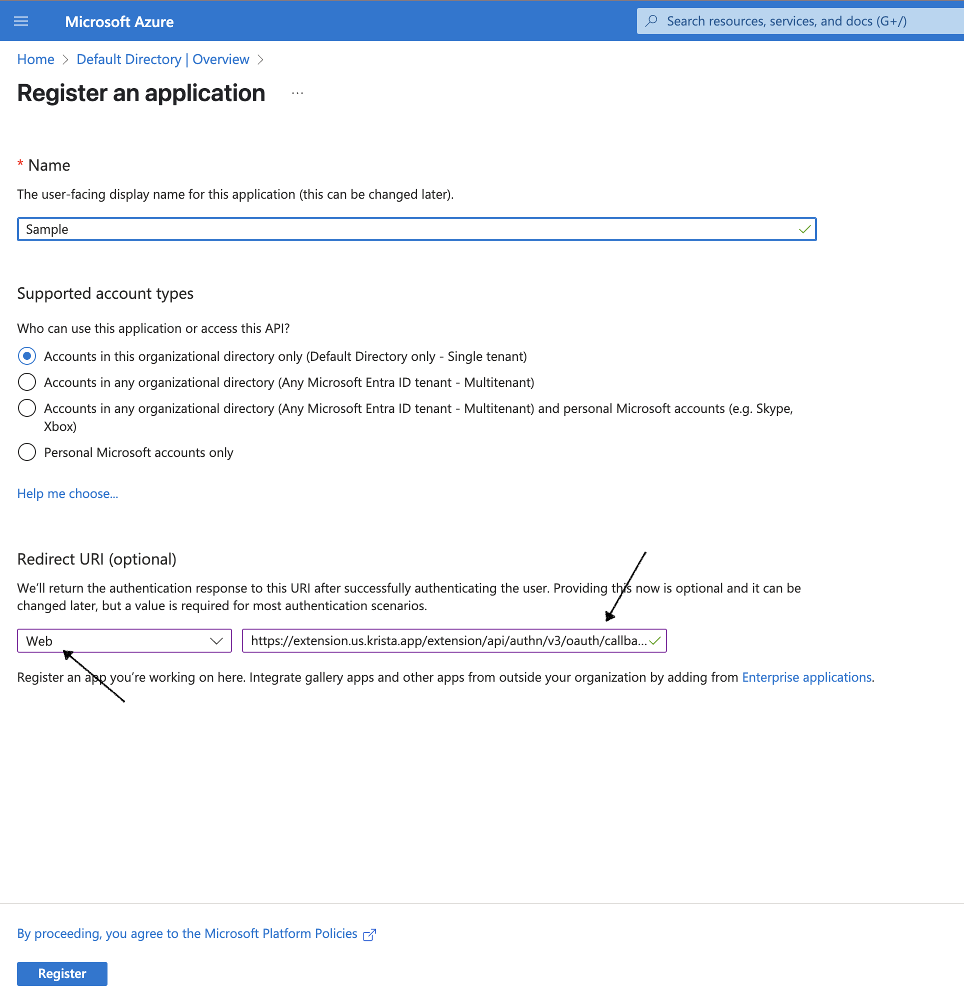
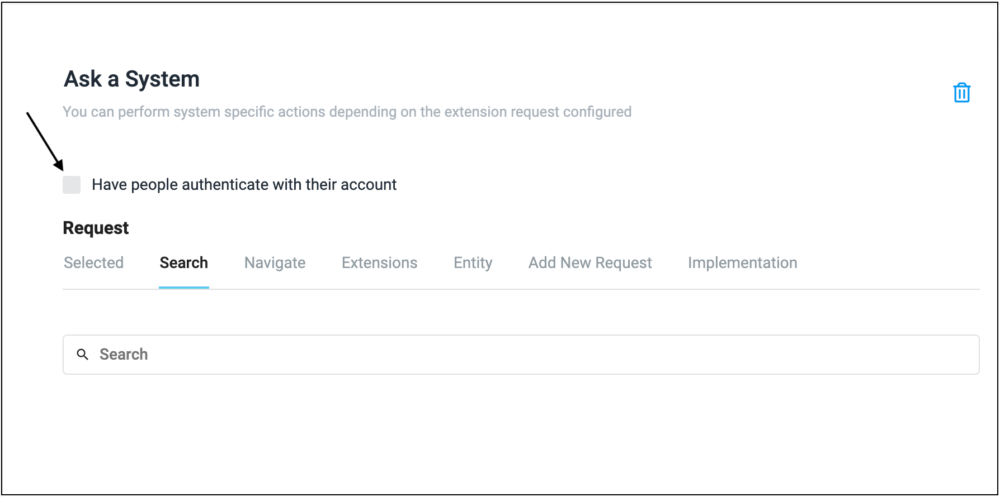
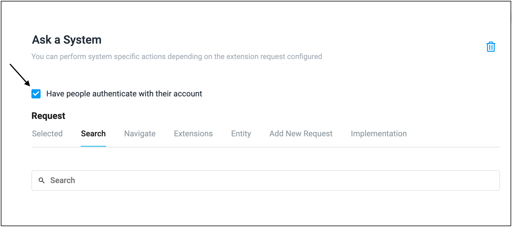

# Extension Configuration

## Overview

This guide provides step-by-step instructions for configuring the Microsoft Entra ID Extension in your Krista environment. Proper configuration is essential for establishing secure communication between Krista and your Microsoft Entra ID tenant.

## Configuration Parameters

The following parameters are required to configure the Microsoft Entra ID Extension:

| Parameter | Type | Required | Description | Example |
|-----------|------|----------|-------------|---------|
| Client ID | Text | Yes | Application (client) ID from Microsoft Entra ID app registration | `a1b2c3d4-e5f6-7890-abcd-ef1234567890` |
| Client Secret | Text (Secured) | Yes | Client secret value from Microsoft Entra ID app registration | `abc123XYZ~def456...` |
| Tenant ID | Text (Secured) | Yes | Directory (tenant) ID from Microsoft Entra ID | `9876fedc-ba98-7654-3210-fedcba987654` |
| Email | Text | Yes | Administrator email address for service account authentication | `admin@yourcompany.com` |
| Auth Type | Pick One | Yes | Authentication mode: Public or Private | Private |

### Parameter Details

#### Client ID
- **Source**: Microsoft Entra ID app registration → Overview → Application (client) ID
- **Format**: GUID (Globally Unique Identifier)
- **Security**: Not secured (public identifier)
- **Purpose**: Identifies your application to Microsoft Entra ID
- **Example**: `a1b2c3d4-e5f6-7890-abcd-ef1234567890`

#### Client Secret
- **Source**: Microsoft Entra ID app registration → Certificates & secrets → Client secret value
- **Format**: Alphanumeric string with special characters
- **Security**: **HIGHLY SENSITIVE** - Store securely, never expose in client-side code
- **Expiration**: Secrets expire (typically 6, 12, or 24 months) - set reminders to renew
- **Important**: Copy the value immediately when created; it's only shown once
- **Example**: `abc123XYZ~def456GHI.jkl789-MNO012`

#### Tenant ID
- **Source**: Microsoft Entra ID app registration → Overview → Directory (tenant) ID
- **Format**: GUID (Globally Unique Identifier)
- **Security**: Secured parameter in Krista
- **Purpose**: Identifies your Microsoft Entra ID tenant/organization
- **Example**: `9876fedc-ba98-7654-3210-fedcba987654`

#### Email
- **Purpose**: Administrator email for service account authentication and token management
- **Format**: Valid email address
- **Usage**: Used to store and retrieve refresh tokens for the service account
- **Validation**: Must be a valid email format
- **Note**: This should be the same email used during the initial OAuth authorization
- **Example**: `admin@yourcompany.com`

#### Auth Type
- **Options**:
  - **Private**: Use your own Microsoft Entra ID app registration (recommended for production)
  - **Public**: Use Krista's shared app registration (for testing only)
- **Default**: Private
- **Recommendation**: Always use Private for production environments
- **Security**: Private mode provides better security and isolation

## Step-by-Step Setup

### Step 1: Create Microsoft Entra ID App Registration

Before configuring the extension, you must create a Microsoft Entra ID app registration. Follow the detailed guide in [Creating Microsoft Entra ID App](pages/CreatingMicrosoftEntraIDApp.md).

### Step 2: Gather Required Credentials

From your Microsoft Entra ID app registration, collect:

1. **Client ID**: Found in Overview → Application (client) ID
2. **Client Secret**: Created in Certificates & secrets → New client secret
3. **Tenant ID**: Found in Overview → Directory (tenant) ID


### Step 3: Configure Extension in Krista

1. Navigate to the Microsoft Entra ID Extension in your Krista workspace
2. Click on the **Setup** tab
3. Fill in the configuration parameters:

#### Configure Client ID

1. Locate the **Client ID** field
2. Paste the Application (client) ID from your Microsoft Entra ID app registration
3. Verify the GUID format is correct (8-4-4-4-12 hexadecimal digits)

#### Configure Client Secret

1. Locate the **Client Secret** field (marked as secured)
2. Paste the client secret value you copied when creating the secret
3. **Important**: Ensure you copy the **Value**, not the **Secret ID**
4. The field will be masked after saving for security

#### Configure Tenant ID

1. Locate the **Tenant ID** field (marked as secured)
2. Paste the Directory (tenant) ID from your Microsoft Entra ID app registration
3. Verify the GUID format is correct

#### Configure Email

1. Locate the **Email** field
2. Enter the administrator email address
3. **Important**: This email will be used to store refresh tokens
4. Use the same email you'll use for OAuth authorization

#### Select Auth Type

1. Locate the **Auth Type** dropdown
2. Select **Private** (recommended for production)
3. Select **Public** only for testing purposes

### Step 4: Configure Redirect URI

The Redirect URI is critical for OAuth 2.0 authentication flow.

1. In the Krista extension **Details** tab, locate the **Extension Base URL**
2. Copy the base URL (e.g., `https://your-instance.krista.ai`)
3. Append `/rest/microsoftentraid/callback` to create the full redirect URI
4. Example: `https://your-instance.krista.ai/rest/microsoftentraid/callback`



5. In Microsoft Entra ID app registration:
   - Navigate to **Authentication** → **Platform configurations**
   - Click **Add a platform** → **Web**
   - Enter the redirect URI
   - Click **Configure**



### Step 5: Validate Configuration

1. Click the **Validate** button in the Krista extension setup page
2. You will be redirected to Microsoft's authentication page
3. Sign in with the administrator account
4. Grant the requested permissions
5. You will be redirected back to Krista
6. Verify that the validation was successful

### Step 6: Test Connection

1. Click the **Test Connection** button
2. Verify that the connection test passes
3. If successful, you're ready to use the extension

## Authentication Type Selection

The Microsoft Entra ID Extension supports two authentication modes that determine how operations are performed.

### Service Account Authentication

- **When to Use**: For automated workflows and system-to-system integrations
- **How to Enable**: Uncheck the "Have people authenticate with their account" checkbox
- **Behavior**: All operations are performed using the service account credentials
- **Token**: Uses the refresh token associated with the administrator email
- **Permissions**: Operations are subject to the service account's permissions



### User Account Authentication

- **When to Use**: When operations should be performed in the context of individual users
- **How to Enable**: Check the "Have people authenticate with their account" checkbox
- **Behavior**: Each user must authenticate with their own Microsoft Entra ID account
- **Token**: Each user gets their own access and refresh tokens
- **Permissions**: Operations are subject to each user's permissions in Microsoft Entra ID



## Redirect URI Configuration

### Understanding Redirect URIs

The Redirect URI (also called callback URL) is where Microsoft Entra ID sends the user after authentication. It must match exactly between your Krista configuration and your Microsoft Entra ID app registration.

### Format

```
https://<your-krista-instance>/rest/microsoftentraid/callback
```

### Examples

- Production: `https://prod.krista.ai/rest/microsoftentraid/callback`
- Staging: `https://staging.krista.ai/rest/microsoftentraid/callback`
- Development: `https://dev.krista.ai/rest/microsoftentraid/callback`

### Configuration Steps

1. **In Krista**:
   - The redirect URI is automatically constructed from your Extension Base URL
   - No manual configuration needed in Krista

2. **In Microsoft Entra ID**:
   - Navigate to your app registration
   - Go to **Authentication** → **Platform configurations**
   - Add the redirect URI under **Web** platform
   - Ensure the URI matches exactly (including https://)

### Common Issues

| Issue | Cause | Resolution |
|-------|-------|------------|
| "Redirect URI mismatch" error | URI in Microsoft Entra ID doesn't match Krista | Verify exact match including protocol and path |
| Authentication fails silently | Wrong platform type selected | Use "Web" platform, not "Single-page application" |
| Localhost not working | Using http instead of https | Use https even for localhost or configure exception |

## Security Considerations

### Best Practices

1. **Protect Client Secret**:
   - Never commit client secrets to version control
   - Rotate client secrets regularly (every 6-12 months)
   - Use Azure Key Vault for additional security in production
   - Set expiration reminders 30 days before secret expires

2. **Use Least Privilege**:
   - Grant only the minimum required API permissions
   - Use Service Account mode for automated workflows
   - Use User Account mode when user context is required

3. **Monitor Authentication**:
   - Regularly review sign-in logs in Microsoft Entra ID
   - Set up alerts for unusual authentication patterns
   - Monitor failed authentication attempts

4. **Secure Email Configuration**:
   - Use a dedicated service account email
   - Don't use personal email addresses
   - Ensure the email account has MFA enabled

5. **Environment Separation**:
   - Use separate app registrations for dev, staging, and production
   - Never share credentials across environments
   - Test configuration changes in non-production first

### Security Checklist

- [ ] Client secret is stored securely
- [ ] Client secret expiration reminder is set
- [ ] Redirect URI uses HTTPS
- [ ] Service account email has MFA enabled
- [ ] API permissions are reviewed and minimized
- [ ] Sign-in logs are monitored regularly
- [ ] Separate app registrations for each environment
- [ ] Test connection successful

## Troubleshooting

### Configuration Validation Fails

**Symptom**: Validation button fails or shows error

**Possible Causes**:
1. Incorrect Client ID, Client Secret, or Tenant ID
2. Client secret has expired
3. Redirect URI mismatch
4. Required API permissions not granted

**Resolution**:
1. Verify all credentials are copied correctly
2. Check client secret expiration date
3. Ensure redirect URI matches exactly
4. Grant admin consent for API permissions

### Test Connection Fails

**Symptom**: Test Connection button fails

**Possible Causes**:
1. OAuth authorization not completed
2. Refresh token expired or revoked
3. Network connectivity issues
4. API permissions insufficient

**Resolution**:
1. Complete the validation/authorization flow first
2. Re-authorize if refresh token expired
3. Check network connectivity to Microsoft Graph API
4. Verify API permissions are granted with admin consent

### Authentication Redirect Fails

**Symptom**: After clicking Validate, redirect doesn't work

**Possible Causes**:
1. Redirect URI not configured in Microsoft Entra ID
2. Redirect URI mismatch
3. Browser blocking redirects

**Resolution**:
1. Add redirect URI to app registration
2. Verify exact match (case-sensitive)
3. Check browser settings and allow redirects

### "Invalid Client" Error

**Symptom**: Error message "invalid_client" during authentication

**Possible Causes**:
1. Client ID is incorrect
2. Client secret is incorrect or expired
3. App registration is disabled

**Resolution**:
1. Verify Client ID from app registration Overview
2. Generate new client secret if expired
3. Ensure app registration is enabled

### Token Refresh Fails

**Symptom**: Operations fail with authentication errors after initial success

**Possible Causes**:
1. Refresh token expired (typically after 90 days of inactivity)
2. User password changed
3. Admin revoked consent
4. Conditional access policy changed

**Resolution**:
1. Re-authorize through the Validate button
2. Ensure service account password is stable
3. Re-grant admin consent if revoked
4. Review and adjust conditional access policies

## See Also

- [Authentication](pages/Authentication.md) - Detailed OAuth 2.0 authentication flow
- [Creating Microsoft Entra ID App](pages/CreatingMicrosoftEntraIDApp.md) - App registration guide
- [Microsoft Graph API Permissions](https://learn.microsoft.com/en-us/graph/permissions-reference) - Official permission reference

