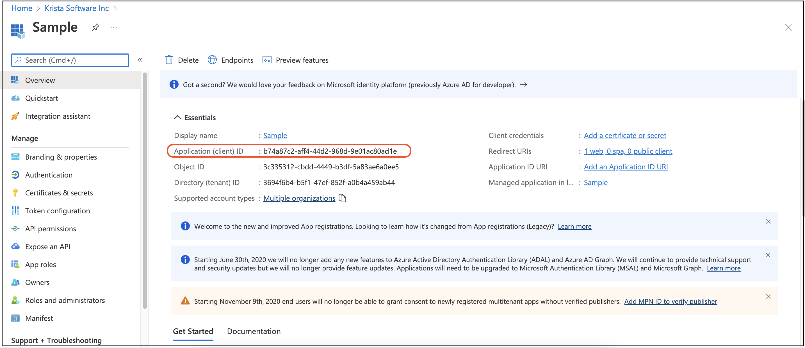
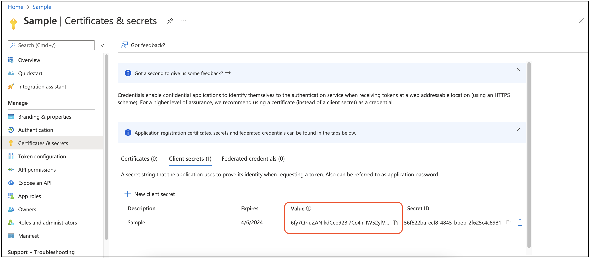
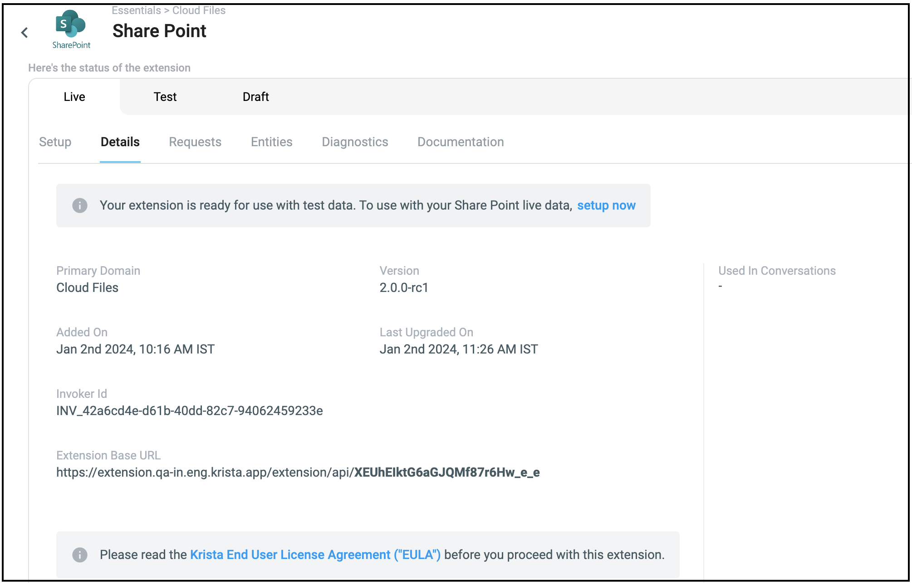
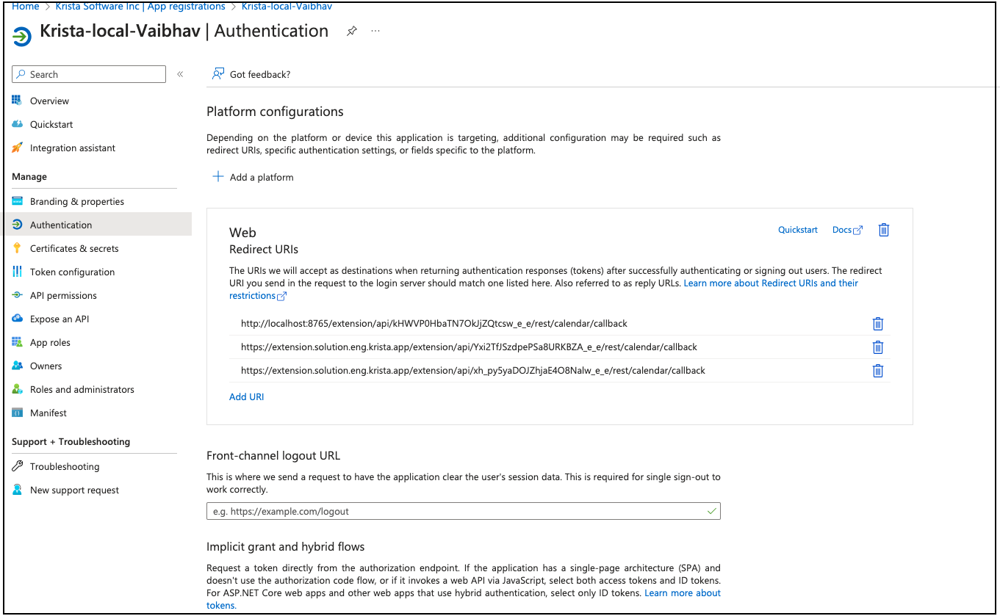
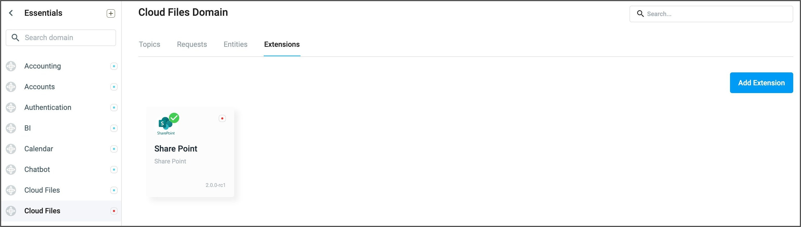
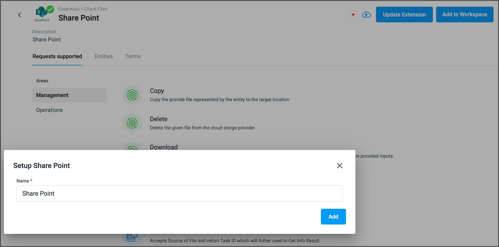
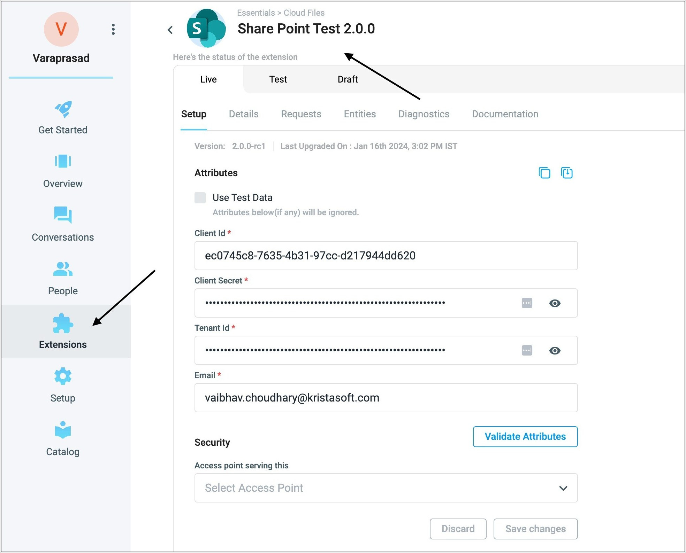
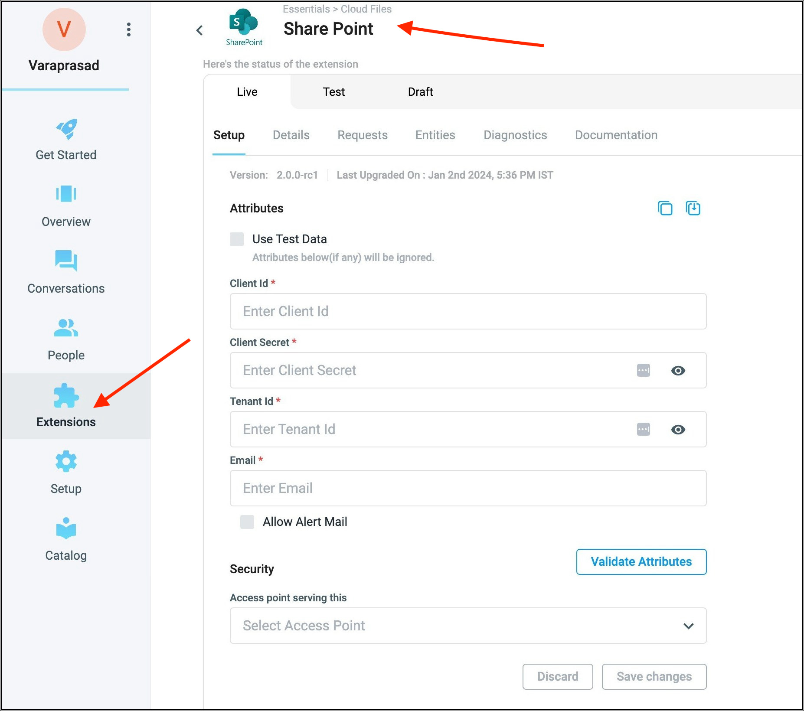

# Configuring SharePoint Extension in Krista

### Steps for connection

* Client ID and Client Secret:
  * To make connection, you have to provide client id and client secret in setup parameters from your registered web application in azure portal. You can get these parameters from **Credentials** tab of the project selected.
    
    

* Once you have provided the client id and client secret you must authorize yourself with the same account which is used to register the application in azure portal.

* To authorize yourself you are required to follow these steps:
   * Go to the Details page of the extension and copy the Routing id from there. After that, append **"/rest/sharepoint/callback"** at the end of the routing id (This is you redirect URI). Now add this URI in Authorized redirect URI in credentials of your registered app in azure portal.
     
     
   * Run one of the request of the extension through conversation in the client. Once you run the request in the client, an authentication will appear. Click on that tab and authorize yourself using the same account which is used to register your application in azure portal.

### Setup SharePoint extension

* Adding SharePoint extension by going to **Catalogs** > **Essentials** > **Cloud Files** > **SharePoint**   
  

* Add Extension To Workspace , Click on **"Add to Workspace"** button and provide Extension Name in **Setup SharePoint** and Click on **"Save"**.
  

* Go to **Extensions** > **SharePoint** , and get into Setup page Tab.
    

* Now you can use **Client Id** , **Client Secret**, **Tenant Id** and **Email** as Setup Parameters which you have Obtained previously.
  * Go to Setup Page and add parameters as below Example used for a Microsoft OAuth 2.0 Setup:

    * **Client Id** : "4uhu24givb35y39b399bv39".
    * **Client Secret** : "your_client_secret".
    * **Tenant Id** : "your_tenant_id".
    * **Email** : "sharepoint.testmail@contoso.com".
    
  

* Once you are authorized, you can see if the connection is established by clicking test connection on setup page.

* After the connection is established, you are good to go with the requests of the extension.

